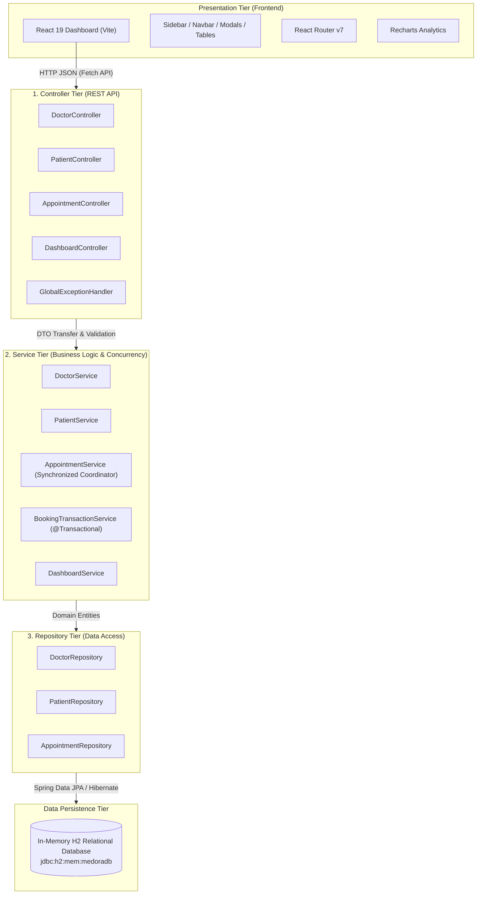
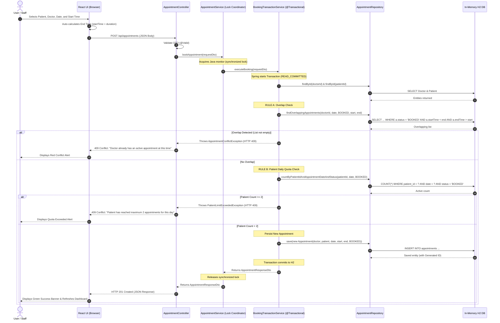
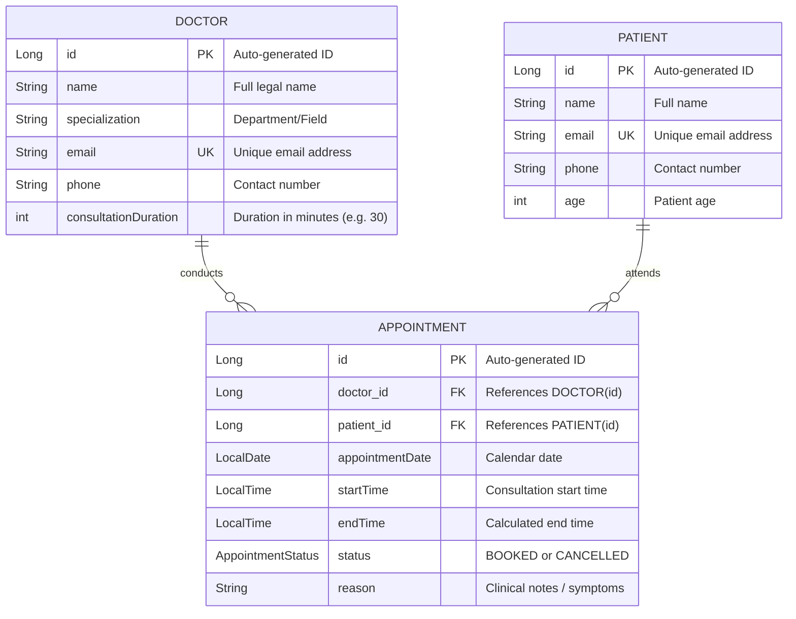

# MEDORA — Architecture & Technical Design Document

This document provides a comprehensive technical overview of the software architecture, entity relationships, request flow, and concurrency design of the **MEDORA Hospital Appointment Management System**.

---

## 1. High-Level Three-Layer Architecture

MEDORA follows the classic **Three-Layer Architectural Pattern**, ensuring strict separation of concerns, high maintainability, and clean testability.



---

## 2. Layer Responsibilities

### 1. Presentation Tier (React Frontend)
- **Role:** Handles user interaction, form inputs, dynamic client-side validation, and data visualization.
- **Key Modules:**
  - `DashboardPage`: Overview metrics, weekly volume charts, today's appointments table.
  - `DoctorsPage`: Doctor directory, specialist tags, and modal registration.
  - `PatientsPage`: Patient directory, age profiles, and modal registration.
  - `AppointmentsPage`: Filterable tabular view with modal cancellation.
  - `BookAppointmentPage`: Interactive booking wizard with live summary calculation.
  - `SchedulePage`: Chronological daily timeline schedule.

### 2. Controller Tier (Spring Web REST Controllers)
- **Role:** Exposes RESTful endpoints, handles HTTP routing, unpacks JSON into DTOs, and invokes validation.
- **Key Characteristics:**
  - Controllers **never** interact directly with repositories; all requests are delegated to the Service tier.
  - Intercepts validation errors via `@Valid` and returns standard HTTP `400 Bad Request`.
  - Maps exceptions uniformly via `GlobalExceptionHandler` (`404 Not Found`, `409 Conflict`, `500 Internal Error`).

### 3. Service Tier (Business Rules & Transaction Boundary)
- **Role:** Encapsulates the core business rules of the hospital.
- **Enforced Rules:**
  - **Rule A (Doctor Overlap):** `existing.startTime < requested.endTime && existing.endTime > requested.startTime`.
  - **Rule B (Patient Limit):** Maximum 2 active `BOOKED` appointments per patient on the same calendar date.
  - **Rule C (Cancellation):** Marks status as `CANCELLED`, freeing the slot and restoring quota.
  - **Concurrency Coordinator:** Employs synchronized coordination around the transactional boundary.

### 4. Repository Tier (Spring Data JPA)
- **Role:** Provides high-performance database abstractions over H2 SQL tables.
- **Key Characteristics:**
  - Extends `JpaRepository<T, ID>` for out-of-the-box CRUD.
  - Implements custom JPQL queries for overlap detection and active count calculations.

---

## 3. Detailed Appointment Booking Flow

The sequence diagram below illustrates the complete booking lifecycle, including the rejection branches for Rule A and Rule B.



---

## 4. Entity-Relationship Diagram (ERD)



---

## 5. Concurrency Architecture & Thread Safety

### Concurrency Vulnerability in Single-Layer Services
In Spring applications, combining `synchronized` and `@Transactional` on the same method is a well-known anti-pattern:
```java
// VULNERABLE PATTERN:
@Transactional
public synchronized AppointmentResponseDto bookAppointment(...) {
    // 1. Conflict check
    // 2. Save
    // 3. Method exit -> Java monitor released HERE!
    // 4. Spring Transaction Proxy commits AFTER monitor release!
}
```
If Thread 2 arrives between steps 3 and 4, it enters the method before Thread 1's changes are visible in the database, resulting in a race-condition duplicate booking.

### The MEDORA Two-Service Isolation Pattern
To solve this cleanly in a single application instance, MEDORA decouples the locking boundary from the transactional proxy:

```
[ Incoming Request (Thread 1) ]       [ Incoming Request (Thread 2) ]
              │                                      │
              ▼                                      ▼
┌───────────────────────────────────────────────────────────┐
│ AppointmentService.bookAppointment()                      │
│ ➔ Acquires Java Monitor (synchronized)                     │
│    (Thread 1 enters critical section)                     │
│    (Thread 2 is BLOCKED waiting on monitor)               │
│                                                           │
│    ┌─────────────────────────────────────────────────┐    │
│    │ BookingTransactionService.executeBooking()      │    │
│    │ 1. Transaction BEGIN (READ_COMMITTED)           │    │
│    │ 2. Read conflict state from H2                  │    │
│    │ 3. Save Appointment                             │    │
│    │ 4. Transaction COMMIT                           │    │
│    └─────────────────────────────────────────────────┘    │
│                                                           │
│ ➔ Thread 1 exits synchronized method (monitor released)   │
└───────────────────────────────────────────────────────────┘
              │
              ▼ (Monitor Released)
[ Thread 2 now enters critical section ]
➔ Calls BookingTransactionService.executeBooking()
➔ Query sees Thread 1's COMMITTED appointment!
➔ Conflict detected! Throws 409 Conflict.
```

This guarantees 100% thread safety without requiring distributed locks or heavyweight external brokers.
